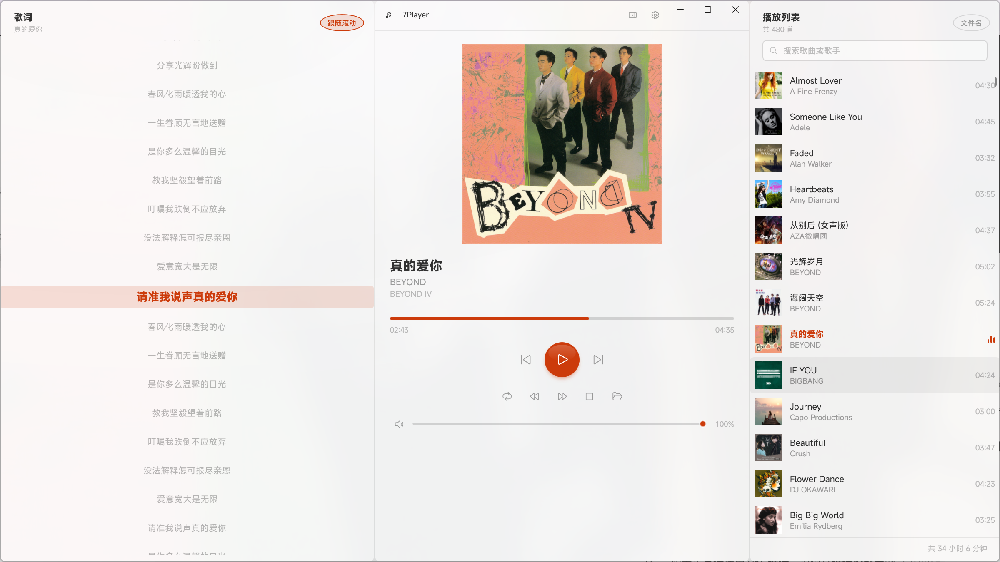

# QiPlayer

面向 Windows 11 的本地音乐播放器，采用 Fluent 2 风格的三栏界面：歌词、正在播放、播放列表各自独立，可随时收起。



> 当前版本：**v1.0.0**

## 功能

- **三栏布局**：歌词 / 正在播放 / 播放列表三栏并列，左右两栏可独立显示或收起，状态跨启动保留。
- **本地音乐库**：选择文件夹后递归扫描，读取标签与内嵌封面，也支持同目录的 `cover` / `folder` 等封面文件。
- **音频格式**：MP3、FLAC、APE、AAC/M4A、WMA、OGG/Opus、WAV、AIFF、WV 等（由 BASS 及其插件解码）。
- **播放控制**：播放 / 暂停、上一曲 / 下一曲、进度拖动与点击跳转、音量与静音、列表循环 / 单曲循环 / 无序播放。
- **歌词**：标准 LRC、翻译行、逐字歌词（卡拉 OK 扫光）；可调字号、行距与字体。
- **播放列表**：搜索过滤、按列排序、自然排序；右键可播放、移出列表、打开所在文件夹、删除到回收站。
- **任务栏挂件**：在任务栏显示当前曲目、控制按钮、滚动标题、单行歌词与 FFT 频谱。
- **媒体 Flyout**：屏幕中央的媒体面板，支持模糊 / 亚克力背景、进度条、停留时长与目标显示器选择。
- **系统集成**：托盘图标、单实例运行、开机启动、全屏应用运行时自动抑制 Flyout。
- **便携模式**：设置保存在程序目录的 `QiPlayer.settings.xml`，支持导入 / 导出。

## 环境要求

- Windows 11（Build 22000 或更高），x64
- 构建需要 [.NET 10 SDK](https://dotnet.microsoft.com/download)
- 框架依赖发布时，运行需要 .NET 10 Desktop Runtime

## 构建与运行

```bash
dotnet build QiPlayer.slnx -c Release
```

```bash
dotnet run --project src/QiPlayer/QiPlayer.csproj
```

## 发布

框架依赖（体积小，需要安装 Desktop Runtime）：

```bash
dotnet publish src/QiPlayer/QiPlayer.csproj -c Release -r win-x64 --self-contained false -o publish
```

自包含（无需预装运行时，体积较大）：

```bash
dotnet publish src/QiPlayer/QiPlayer.csproj -c Release -r win-x64 --self-contained true -o publish
```

BASS 原生库（`Assets/bass/*.dll`）会在构建时自动复制到输出目录，必须与 `QiPlayer.exe` 位于同一目录。

## 目录结构

```
src/QiPlayer/
├─ Audio/         BASS 播放引擎与频谱数据源
├─ Classes/       主题、窗口辅助、Win32 互操作、设置模型与持久化
├─ Controls/      卡拉 OK 文本、任务栏媒体控件、环境背景
├─ Converters/    XAML 值转换器
├─ Models/        歌曲数据模型
├─ Services/      文件夹扫描、标签读取、封面解析、歌词解析、回收站
├─ Styles/        设计令牌与控件样式
├─ ViewModels/    播放器视图模型
└─ Windows/       歌词、播放列表、Media Flyout、任务栏挂件窗口
```

## 第三方组件

| 组件 | 用途 | 许可证 |
| --- | --- | --- |
| [WPF-UI](https://github.com/lepoco/wpfui) | Fluent 2 控件与窗口 | MIT |
| [WPF-UI.Tray](https://github.com/lepoco/wpfui) | 托盘图标 | MIT |
| [MicaWPF](https://github.com/Simnico99/MicaWPF) | Mica 背景与强调色 | MIT |
| [CommunityToolkit.Mvvm](https://github.com/CommunityToolkit/dotnet) | MVVM 源生成器 | MIT |
| [ManagedBass](https://github.com/ManagedBass/ManagedBass) | BASS 的 .NET 封装 | MIT |
| [TagLib#](https://github.com/mono/taglib-sharp) | 音频标签与内嵌歌词读取 | LGPL-2.1 |
| [BASS](https://www.un4seen.com/) 及插件 | 音频解码与输出 | 专有软件，非商业用途免费 |

> **BASS 授权提醒**：BASS 及其插件由 un4seen developments 提供，可免费用于非商业用途；商业用途需要另行购买授权。详见 [un4seen 授权说明](https://www.un4seen.com/)。

## 许可证

本项目以 [GNU General Public License v3.0](LICENSE) 发布。

界面与部分实现参考了以下 GPL-3.0 项目，特此致谢：

- [FluentFlyout](https://github.com/unchihugo/FluentFlyout)（Hugo Li）：设置模型、媒体 Flyout 与任务栏挂件的交互设计。
- [MusicPlayer2](https://github.com/zhongyang219/MusicPlayer2)：LRC 解析与歌词显示方案。
